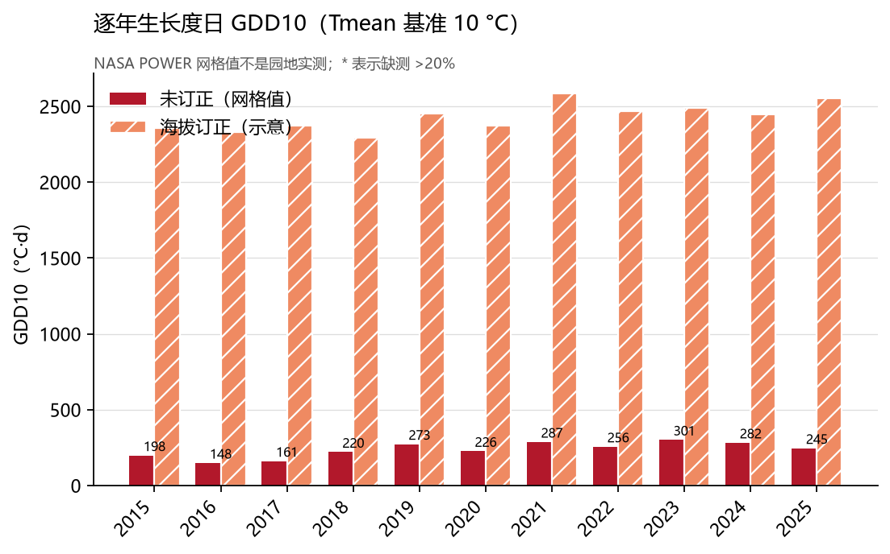

# vineclim

高海拔葡萄园的气候指标计算与可复现报告：GDD、Huglin、冷夜、霜冻、高温、生长季长度与昼夜温差。

[](https://github.com/YilongXiao/vineclim/actions/workflows/ci.yml)
[](LICENSE)
[](pyproject.toml)



*德钦 NASA POWER 网格序列（2015–2025）的逐年 GDD10。深色为未订正网格值，斜线柱为假定园地 2200 m 的示意订正（6.5 °C/km，+10.92 °C）；图由 vineclim 实际运行生成。网格值不是园地实测。*

## 为什么做

高海拔葡萄园的热量与霜冻窗口都很紧，评估时又必须同时看热量累积、成熟期夜温和霜冻日期；零散的电子表格既留不下公式版本，也容易把公开网格值当成园地实测。vineclim 把指标定义、缺测规则、数据性质声明和图表固定在同一个可复现流程里，让报告可以逐项复核、逐年重跑。

## 安装

需要 Python 3.10 或更新版本（CI 覆盖 3.11 / 3.12）。建议使用虚拟环境。

Windows PowerShell：

```powershell
py -3.12 -m venv .venv
.venv\Scripts\Activate.ps1
pip install -e ".[dev]"
```

macOS / Linux：

```bash
python3 -m venv .venv
source .venv/bin/activate
pip install -e ".[dev]"
```

> PowerShell 若提示禁止运行脚本，可先执行
> `Set-ExecutionPolicy -Scope Process -ExecutionPolicy Bypass`。

## 快速开始

以下命令使用仓库内的合成演示数据，产物写入 `out/synthetic/`：

```bash
vineclim --help
vineclim compute examples/synthetic_station.csv --lat 28.5 --year 2024 --source-type synthetic -o out/synthetic
pytest -q
```

`compute` 的真实输出：

```text
vineclim 完成。
年份: 2024–2024 | 半球: north | 纬度: 28.500
数据性质: synthetic
  -> out\synthetic\indices.json
  -> out\synthetic\indices.csv
  -> out\synthetic\report.md
  -> out\synthetic\annual-gdd.png
  -> out\synthetic\frost-calendar.png
  -> out\synthetic\climatology.png
insufficient_data 条目: 1/9
```

合成数据故意包含三段连续缺测，用于演示 `insufficient_data` 和缺测比例，不可当作观测结论。

### 德钦示例（NASA POWER 网格 + 2200 m 订正演示）

```bash
vineclim compute examples/deqin_power_2015_2025.csv \
  --lat 28.55 --lon 98.86 \
  --station-elev 2200 --grid-elev 3879.6 \
  --site-name 德钦 -o out/deqin
```

真实输出节选：

```text
vineclim 完成。
年份: 2015–2025 | 半球: north | 纬度: 28.550
数据性质: power-grid
注意: POWER 网格值不是园地实测。
海拔订正（示意）: +10.92 °C；报告同时保留未订正与订正值。
insufficient_data 条目: 0/99
```

`out/deqin/report.md` 中的多年气候概况节选：

| 指标 | 单位 | 多年均值（未订正） | 多年均值（订正） | 可用年数 | 指示性分级 |
|---|---:|---:|---:|---:|---|
| 生长度日 GDD10 | °C·d | 235.92 | 2429.28 | 11 | 冷凉（很短的成熟窗口） |
| Huglin 热指数 HI | °C·d | 579.56 | 2468.67 | 11 | 过冷（too cold） |
| 冷夜指数 CI | °C | 5.57 | 16.49 | 11 | 夜很冷（very cool nights） |
| 全年霜冻日 | d | 194.09 | 9.36 | 11 | 霜冻风险较高 |
| 生长季长度 | d | 111.45 | 303.00 | 11 | 生长季短 |

完整的逐年表、缺测计数与订正状态见生成的 `out/deqin/report.md`、`indices.csv` 与 `indices.json`。

## 输入格式与输出说明

输入必须是 UTF-8 CSV，列名固定为：

| 列 | 单位 | 说明 |
|---|---|---|
| `date` | — | `YYYY-MM-DD`，逐日一行；重复日期报错 |
| `tmin_c` | °C | 日最低气温；不得高于 `tmax_c` |
| `tmax_c` | °C | 日最高气温 |
| `precip_mm` | mm | 日降水量；当前仅用于气候概况图，不参与指标 |

空单元格以及 POWER 填充值 `-999` / `-9999` 都视为缺测。输入会自动按日期排序，多余列会被丢弃。日期非法、缺列、重复日期或 `tmin_c > tmax_c` 时以退出码 2 失败。

每次运行写出：

- `indices.json`：机器可读结果，含指标定义、数据性质、订正参数与免责声明；
- `indices.csv`：`year,metric,value,value_corrected,n_days,n_missing,missing_fraction,status,status_corrected`；
- `report.md`：中文 Markdown 报告，分列未订正 / 订正值与 `insufficient_data` 状态；
- `annual-gdd.png`、`frost-calendar.png`、`climatology.png`：实际结果图（`--no-plots` 可关闭）。

常用选项：

- `--year 2020 --year 2023`：仅算指定年；或 `--start-year 2015 --end-year 2025`。
- `--station-elev` / `--grid-elev`：成对提供才启用海拔订正；`--lapse` 默认 6.5 °C/km。
- `--source-type auto|power-grid|station|synthetic`：写入报告的数据性质，默认按文件名推断。
- `--source-note`、`--site-name`：来源备注与站点名。
- `vineclim fetch --lat 28.55 --lon 98.86 --start 2015 --end 2025 -o data.csv`：从 NASA POWER 下载并转成上述 CSV（需联网，可加 `--metadata` 保存响应元数据）。
- `vineclim report` 与 `compute` 参数相同，`-o` 默认 `vineclim-report/`。

退出码：0 成功；2 参数或数据错误；3 网络下载失败。

## 方法与局限摘要

- `Tmean = (Tmin + Tmax) / 2`，GDD10 的基温为 10 °C，Huglin 使用北半球 4–9 月 / 南半球 10–3 月窗口与纬度系数 `k`。
- 冷夜指数取北半球 9 月 / 南半球 3 月的平均 Tmin；霜冻日按 `Tmin < 0 °C` 计数；生长季长度为 `Tmean ≥ 10 °C` 的累计天数（非连续）。
- 缺测比例 **> 20 %** 的指标/年份标记为 `insufficient_data`，值为 `null`，不进入多年均值；恰好 20 % 仍为 `ok`。
- 海拔订正为 `T' = T + lapse × (grid_elev − station_elev) / 1000`，属示意性线性订正，未订正值始终保留。
- 已知局限：网格尺度不匹配、恒定递减率忽略逆温与坡位、累计指标会因缺测偏低、霜冻未结合芽期、分级来自温带产区、无辐射/水分指标。

完整公式、单位、阈值、文献与局限见 [docs/methods.md](docs/methods.md)。

## 数据来源与是否合成

| 文件 | 性质 | 说明 |
|---|---|---|
| `examples/deqin_power_2015_2025.csv` | **公开网格数据** | NASA POWER Daily API，`T2M_MAX,T2M_MIN,PRECTOTCORR`，98.86°E / 28.55°N，2015-01-01–2025-12-31，检索于 2026-11-17 |
| `examples/deqin_power_metadata.json` | 元数据 | POWER API 版本、来源、填充值、格点海拔 3879.61 m |
| `examples/synthetic_station.csv` | **合成演示** | 2024 年虚构站点，正弦季节循环 + 噪声 + 三段故意缺测 |

**重要：** 德钦示例来自网格产品，网格海拔约 3879 m，一个格点覆盖数十公里，**不是园地实测**。示例中的 2200 m 只是为了演示订正方向与量级而假定的园地海拔，并非实测地块。`docs/deqin_2015_2025/` 保存了一次带该演示订正的完整输出，供对照。

`vineclim compute` 主流程完全离线；只有 `vineclim fetch` 访问网络。POWER 解析可以离线测试，失败会重试 3 次并以退出码 3 结束。

## 测试

```bash
pytest -q     # 59 个测试，135 条断言
ruff check .
```

测试覆盖指标手算值、南北半球窗口、闰日、恰好 20 % 与超过 20 % 缺测、缺测跳过与计数、订正方向与双值输出、非法坐标/年份/列/日期、POWER 响应解析与重试、报告与 JSON/CSV 写出。GitHub Actions 在 Ubuntu 与 Windows、Python 3.11 / 3.12 上运行 `ruff` 与 `pytest`。

## 引用

若在论文或报告中使用本工具，请引用（机器可读信息见 [CITATION.cff](CITATION.cff)）：

```bibtex
@software{xiao_vineclim_2026,
  author  = {Xiao, Yilong},
  title   = {vineclim: bioclimatic indices and reproducible reports for high-altitude vineyards},
  year    = {2026},
  version = {0.1.0},
  license = {MIT},
  url     = {https://github.com/YilongXiao/vineclim}
}
```

指标本身请同时引用 [docs/methods.md](docs/methods.md) 中的原始文献（Huglin 1978；Tonietto & Carbonneau 2004）。

## English summary

vineclim computes GDD10, the Huglin heliothermal index, cool night index,
frost days, hot days, growing-season length and diurnal range from daily
minimum and maximum temperature for high-altitude vineyard climate screening.

It reads station CSV files or NASA POWER grid downloads, applies optional
hemisphere-aware windows, and writes JSON, CSV, a Chinese Markdown report and
publication-style figures from the same computed result.

Years with more than 20 % missing days are flagged `insufficient_data`; an
optional constant-lapse elevation correction is always reported next to
uncorrected values. The bundled Deqin example is NASA POWER grid data at an
elevation of about 3879 m, not a vineyard measurement; 2200 m is an
illustrative correction target. Temperate-zone index classes are comparative
only, and the tool computes no radiation, humidity or water-balance terms.

## License

[MIT](LICENSE) © 2026 Yilong Xiao
